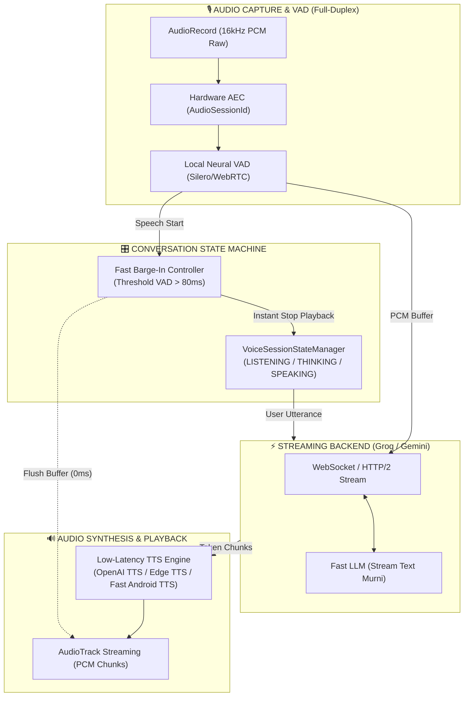

# 🎙️ DEEP AUDIT: NOVA AGENT V3 — REAL-TIME NATURAL VOICE ENGINE
> **Status:** Deep Audit Selesai • **Target:** Real-Time Conversational Voice AI (ChatGPT Voice Parity)  
> **Auditor:** Senior Android Audio & Real-Time Conversational AI Systems Architect  
> **Repository:** `Nova-Agent-V3` • **Tanggal:** 18 November 2026  

---

## 1. Executive Summary

Nova Agent V3 memiliki visi besar menjadi asisten AI otonom berbasis suara dengan kemampuan kontrol perangkat Android langsung. Namun, dari hasil deep audit teknis terhadap implementasi aktual pada source code (`NovaAudioDirector.java`, `UniversalNetworkClient.java`, `AutonomousLoopEngine.java`, `CognitiveCore.java`, dan kelas pendukung), **sistem suara saat ini belum memenuhi kriteria real-time natural conversational AI seperti ChatGPT Voice.**

### Diagnosa Inti:
1. **Bukan Real-Time Voice Streaming Murni**: Sistem saat ini adalah arsitektur *Turn-Based / Half-Duplex* klasik yang disimulasikan menyerupai streaming. Audio mikrofon tidak di-stream secara mentah (raw PCM/WebSocket), melainkan menunggu rekognisi teks lokal Google STT selesai (`onResults`), baru kemudian mengirim request HTTP SSE ke LLM.
2. **Barge-in / Interupsi Rusak Secara Struktural**: Logika *"Full-Duplex Echo-Proof Barge-In"* di `NovaAudioDirector.java` pada praktiknya **tidak aktif saat AI sedang berpikir atau berbicara**. Saat `onResults()` selesai, Android `SpeechRecognizer` otomatis berhenti. `resumeListening()` hanya dipanggil pada callback `onDone()` setelah TTS selesai berbicara. Akibatnya, selama AI memproses dan selama chunk pertama diucapkan, mikrofon dalam kondisi **mati total**.
3. **High Latency Bottleneck (TTFS 2.2 – 5.5 Detik)**: Waktu tunggu keheningan STT (1200ms) + penataan schema JSON di mana teks ucapan (`speech`) diletakkan di **akhir payload** setelah reasoning `thought` dan `action` + buffer klausa kalimat membuat respons pertama terdengar sangat lambat.
4. **Android Audio & Focus Mengabaikan Standar Sistem**: Tidak ada manajemen `AudioFocus`, tidak ada dukungan Bluetooth SCO/Headset, dan `AcousticEchoCanceler` serta `NoiseSuppressor` hanya di-import tetapi **tidak pernah diinisialisasi atau dihubungkan ke audio session**.

---

## 2. Current Voice Architecture

Arsitektur suara saat ini terfragmentasi ke dalam komponen-komponen berikut:

```
[Pengguna Berbicara]
        │
        ▼
[Android SpeechRecognizer (Google GMS)] ───► onPartialResults() / onResults()
        │
        ▼
[LocalIntentRouter] (Offline Pattern Match)
        │
        ├── (Offline Match) ──► EventBus (VOICE_RECEIVED) ──► mouth.speak()
        │
        └── (Online Intent) ──► AutonomousLoopEngine.startTask()
                                        │
                                        ▼
                                [CognitiveCore]
                                        │ (Merge Context & UI Elements)
                                        ▼
                            [UniversalNetworkClient]
                                        │ (HTTP SSE POST ke Groq/Gemini)
                                        ▼ (Chunk by chunk data: {...})
                            [Speech JSON Parser (indexOf manual)]
                                        │
                                        ▼ (AgentEvent.VOICE_STREAM_CHUNK)
                            [NovaAudioDirector.mouth (Android TextToSpeech)]
                                        │
                                        ▼
                                [Speaker HP Android]
```

### Karakteristik Arsitektur Aktual:
- **STT**: Mengandalkan `android.speech.SpeechRecognizer` bawaan OS (Google Recognition Service).
- **LLM**: Menggunakan OkHttp Server-Sent Events (SSE) streaming dengan model Llama-3.3-70b (Groq) atau Gemini-2.0-Flash.
- **TTS**: Android `android.speech.tts.TextToSpeech` lokal (mengandalkan engine TTS yang terinstall di HP, e.g. Google TTS / Samsung TTS).
- **Transport**: Half-duplex HTTP/1.1 REST + SSE. Tidak ada WebSocket full-duplex 2 arah (audio in / audio out).

---

## 3. Actual End-to-End Voice Pipeline

Berikut pelacakan lengkap per tahapan, mulai dari suara pengguna hingga Nova kembali mendengarkan:

| Tahap | Implementasi Aktual | File & Method | Sifat | Streaming? | Bottleneck & Masalah Utama |
|---|---|---|---|---|---|
| **1. Mic Capture** | `SpeechRecognizer` via Android Audio HAL | `NovaAudioDirector.java`<br>`initEar()` | Async | ❌ Tidak (OS buffer) | Bergantung penuh pada Google App/GMS; tidak ada akses raw PCM audio. |
| **2. Audio Processing** | `AudioManager.MODE_IN_COMMUNICATION` | `NovaAudioDirector.java`<br>`initEar()` L.125-129 | Sync | ❌ Tidak | Mode VoIP diset tanpa mengaktifkan AEC hardware; merusak audio aplikasi lain. |
| **3. VAD (Voice Activity)** | Bawaan Google SpeechRecognizer | `RecognitionListener`<br>`onBeginningOfSpeech()` | Async | ⚠️ Terbatas | Ambang batas VAD tidak bisa dikontrol secara programatis oleh developer. |
| **4. Speech-to-Text** | Google Speech Recognition Service | `ear.startListening(earIntent)` | Async | ⚠️ Partial Text saja | Sering timeout (Error 7: No Match); butuh koneksi stabil ke server Google STT. |
| **5. Utterance Finalization** | Silence length 1200ms | `earIntent.putExtra(...)` L.135-136 | Async | ❌ Tidak (Blocking delay) | Menunggu jeda hening 1.2 detik sebelum kata-kata diproses ke LLM. |
| **6. Context Building** | Ambil Short-term + Local RAG SQLite | `CognitiveCore.java`<br>`processEnvironment()` | Sync | ❌ Tidak | Seluruh context digabung sinkron; UI elements dipadatkan sebelum LLM dipanggil. |
| **7. AI Request** | OkHttp POST (SSE alt=sse / stream=true) | `UniversalNetworkClient.java`<br>`executeCallWithRotation()` | Async | ✅ Ya (HTTP chunk) | JSON payload menuntut struktur ketat. |
| **8. LLM Response Stream** | OkHttp `ResponseBody.byteStream()` | `UniversalNetworkClient.java`<br>L.165-234 | Async | ✅ Ya (Token/Chunk) | Loop pembacaan per baris `reader.readLine()`. |
| **9. Text Parsing** | `indexOf("\"speech\":\"")` manual | `UniversalNetworkClient.java`<br>L.199-228 | Sync | ⚠️ Pseudo-stream | Menunggu kunci `"speech"` muncul (setelah thought & action selesai digenerate). |
| **10. Text-to-Speech** | `TextToSpeech.speak()` | `NovaAudioDirector.java`<br>L.286-288 | Async | ⚠️ Chunk Queue | Memecah teks per kalimat (tanda baca), lalu dimasukkan ke antrean TTS Android. |
| **11. Audio Playback** | Media framework via Android TTS | `TextToSpeech` default audio track | Async | ❌ Tidak | Kualitas suara robotik tergantung engine bawaan HP vendor (bukan Neural voice modern). |
| **12. Interrupt Detection** | String comparison vs buffer | `NovaAudioDirector.java`<br>`isGenuineUserInterruption()` | Sync | ❌ Gagal Aktif | Mic mati saat proses berlangsung; filter echo mengandalkan pencocokan string teks mentah. |
| **13. Return to Listening** | `ear.startListening(earIntent)` | `NovaAudioDirector.java`<br>`resumeListening()` L.246 | Async | ❌ Terlambat | Hanya dipanggil saat callback `onDone()` dari TTS selesai dieksekusi. |

---

## 4. File and Method Map

Daftar kelas dan metode konkret yang mengontrol alur suara:

### A. Audio & Voice Layer
- **`com.novaagent.app.core.audio.NovaAudioDirector`**:
  - `initEar()`: Konfigurasi intent pengenal suara, audio mode, dan registrasi `RecognitionListener`.
  - `initMouth()`: Inisialisasi engine `TextToSpeech` dan pendengar progres ucapan `UtteranceProgressListener`.
  - `onResults(Bundle results)`: Titik akhir finalisasi STT, memicu eksekusi perintah ke `AutonomousLoopEngine`.
  - `onPartialResults(Bundle partialResults)`: Menerima teks sementara saat user berbicara; terdapat logika interupsi.
  - `isGenuineUserInterruption(String heardText)`: Algoritma penentu apakah suara yang masuk adalah pantulan speaker sendiri atau suara user.
  - `onEvent(AgentEvent event)`: Mendengarkan chunk streaming (`VOICE_STREAM_CHUNK`) dan pesan utuh (`VOICE_RECEIVED`).
  - `resumeListening()`: Memanggil `ear.cancel()` dan `ear.startListening(earIntent)`.

### B. Network & AI Streaming Layer
- **`com.novaagent.app.data.network.UniversalNetworkClient`**:
  - `executeCallWithRotation(...)`: Membuka koneksi SSE streaming ke endpoint LLM (Groq / Gemini / OpenAI compatible).
  - `onResponse(Call call, Response response)`: Membaca stream baris demi baris (`BufferedReader`).
  - Logika Parser Klausa Natural (L.199–228): Memotong teks ucapan berdasarkan tanda baca (`.`, `?`, `!`, `,`, `;`, `\n`) dan mengirimkan event `VOICE_STREAM_CHUNK`.

### C. Engine & Brain Orchestrator
- **`com.novaagent.app.core.engine.AutonomousLoopEngine`**:
  - `startTask(String task)`: Memulai siklus otonom, mengecek `LocalIntentRouter`, dan memicu pemindaian visual.
  - `onEvent(AgentEvent event)`: Menangani `INTERRUPT_TRIGGERED` untuk membatalkan proses AI aktif (`cancelProcessing()`).
- **`com.novaagent.app.core.brain.CognitiveCore`**:
  - `processEnvironment(...)`: Menyiapkan prompt pesan, menyuntikkan short-term memory dan fakta RAG lokal ke dalam JSON messages.
  - `cancelProcessing()`: Membatalkan HTTP call yang sedang berjalan jika user melakukan interupsi.

---

## 5. Streaming Capability Matrix

| Layer | Status Streaming | Klasifikasi | Bukti Source Code |
|---|---|---|---|
| **STT (Input)** | ⚠️ Parsial / Non-Streaming Pipeline | *Simulated Streaming* | `onPartialResults` menerima kata parsial, tapi **tidak diteruskan** ke LLM sebelum user berhenti berbicara selama 1.2 detik (`onResults`). |
| **LLM (Reasoning)** | ✅ Streaming Aktif | *True Streaming* | OkHttp membaca SSE token-by-token secara kontinu (`UniversalNetworkClient.java` L.170). |
| **JSON Extraction** | ⚠️ Delayed Streaming | *Broken Stream Pipeline* | String JSON di-buffer hingga kunci `"speech"` ditemukan. Karena LLM menghasilkan `"thought"` dan `"action"` lebih dulu, token awal ucapan tertahan. |
| **Sentence Chunking** | ✅ Progressive Chunks | *Chunked Progressive* | Teks ucapan dipotong per klausa tanda baca minimal 8 karakter atau panjang > 65 karakter (`UniversalNetworkClient.java` L.214-222). |
| **TTS (Output)** | ⚠️ Fake / Sequential Chunks | *Queued Sequential* | Menggunakan `mouth.speak(textChunk, TextToSpeech.QUEUE_ADD, ...)`. Tidak ada audio sample streaming; engine TTS mengolah kalimat per kalimat secara terpisah. |

**Kesimpulan Streaming:**
Nova tidak memiliki pipeline audio streaming ujung-ke-ujung (End-to-End Streaming). Aliran terputus menjadi tiga pulau:
1. **Audio In**: Blokir sampai selesai (1.2 detik diam).
2. **Text Generation**: Mengalir via SSE.
3. **Audio Out**: Sintesis blok per kalimat via TTS Android lokal.

---

## 6. Barge-In and Interrupt System Assessment

Fitur interupsi (Barge-in) adalah pembeda utama antara asisten suara kaku dengan asisten percakapan natural.

### 🔴 Temuan Fatal: Siklus Interupsi Terputus (Dead-Lock Interruption)
Pada `NovaAudioDirector.java`:
1. Saat user selesai berbicara, `onResults()` terpanggil. Pada baris 209, tugas dikirim ke `AutonomousLoopEngine`.
2. **`SpeechRecognizer` Android secara otomatis berhenti setelah memanggil `onResults()`**.
3. Kode **tidak** memanggil `resumeListening()` di dalam blok sukses `onResults()`.
4. Selama `AutonomousLoopEngine` berjalan, `CognitiveCore` memanggil Groq, dan LLM melakukan streaming, **mikrofon dalam keadaan OFF (tidak mendengarkan)**.
5. Ketika chunk pertama suara tiba, `mouth.speak(textChunk, TextToSpeech.QUEUE_FLUSH, ...)` dipanggil, dan flag `isCurrentlySpeaking = true`.
6. `resumeListening()` baru dipanggil di baris 79:
   ```java
   @Override public void onDone(String utteranceId) {
       isCurrentlySpeaking = false;
       mainHandler.postDelayed(() -> resumeListening(), 120); 
   }
   ```
7. **Dampak Nyata**: Selama Nova mengucapkan kalimat pertama, mic **mati**. Baru setelah kalimat pertama selesai, mic menyala, tetapi pada saat itu `isCurrentlySpeaking` sudah diset ke `false`! Akibatnya, blok interupsi di baris 179 (`if (isCurrentlySpeaking)`) **hampir mustahil tersentuh**.

### ⚠️ Kelemahan Heuristik Echo Cancellation Berbasis Teks
Pada baris 227–244 `isGenuineUserInterruption`:
```java
private boolean isGenuineUserInterruption(String heardText) {
    String lower = heardText.toLowerCase();
    if (lower.matches(".*\\b(stop|berhenti|diam|tunggu|batal|jangan|cukup|halo nova|hei nova)\\b.*")) {
        return true;
    }
    String spokenSoFar = recentSpokenBuffer.toString().toLowerCase();
    String[] words = lower.split("\\s+");
    int nonEchoWords = 0;
    for (String w : words) {
        if (w.length() > 2 && !spokenSoFar.contains(w)) {
            nonEchoWords++;
        }
    }
    return nonEchoWords >= 2;
}
```
- **Masalah Akustik**: Filter ini mengasumsikan bahwa suara Nova dari speaker yang ditangkap mic akan tertranskripsi oleh Google STT secara identik dengan teks aslinya. Kenyataannya, suara dari speaker yang masuk ke mic terdistorsi oleh akustik ruangan, pantulan gema, dan kompresi, menghasilkan transkripsi sampah (*gibberish words*). Karena kata sampah tersebut tidak ada di `spokenSoFar`, sistem mengira itu adalah user yang sedang menginterupsi (**False Trigger Interrupt**)!
- **Hardware AEC Tidak Digunakan**: `AcousticEchoCanceler` di-import di baris 7, tetapi tidak pernah dibuat dengan `AcousticEchoCanceler.create(audioSessionId)`.

---

## 7. Natural Conversation Assessment (20 Kriteria Audit)

| # | Parameter Evaluasi | Status Aktual | Analisis Teknis Berdasarkan Kode |
|---|---|---|---|
| 1 | Respons langsung setelah selesai bicara | ❌ Buruk | Terhambat jeda hening wajib 1200ms sebelum STT mengirim `onResults`. |
| 2 | Deteksi keheningan tidak konservatif | ❌ Sangat Kaku | 1200ms adalah angka statis di intent; user yang berpikir sejenak langsung terpotong. |
| 3 | Menghindari jeda canggung | ❌ Gagal | Jeda total 2.5–5 detik menciptakan keheningan canggung (dead air). |
| 4 | Berbicara tanpa tombol manual | ✅ Berjalan | Didukung mode `isListeningAbadi = true` yang me-restart STT otomatis. |
| 5 | Bisa diinterupsi saat AI bicara | 🔴 Rusak | Mic mati selama utterance pertama berlangsung; logika interupsi tidak aktif. |
| 6 | Penghentian audio seketika saat diinterupsi | ⚠️ Parsial | Ada kode `mouth.stop()`, tapi hanya bekerja jika event interupsi berhasil tertangkap. |
| 7 | Mengakui interupsi sebagai input baru | ❌ Tidak | Kata interupsi dibuang; `INTERRUPT_TRIGGERED` hanya mereset state tanpa menyimpan ucapan baru. |
| 8 | Menghindari berbicara menimpa user | ❌ Sering Bocor | Tanpa Full-Duplex Audio HAL, TTS dan STT kerap berebut akses audio stream. |
| 9 | Penanganan backchannel ("iya", "hmm") | ❌ Tidak | Kata pendek dianggap perintah penuh, memicu request LLM lengkap yang membuang kuota. |
| 10 | Follow-up pertanyaan tanpa wake-word | ✅ Mendukung | Loop berkelanjutan mendengarkan setiap kalimat setelah Nova selesai bicara. |
| 11 | Konsistensi konteks percakapan | ⚠️ Rentan | FIMO memangkas percakapan di tengah; context mudah loncat pada obrolan panjang. |
| 12 | Penanganan ucapan panjang user | ⚠️ Terbatas | Google STT default kerap memutus kalimat jika ada hening mikro di tengah kalimat. |
| 13 | Bahasa Indonesia natural | ⚠️ Standar | System prompt mengarahkan bahasa santai, namun prosodi TTS Android lokal terdengar kaku/robotik. |
| 14 | Penanganan campuran Indo-Inggris | ❌ Buruk | Locale dikunci ke `"id-ID"`; istilah bahasa Inggris sering ditranskripsi salah oleh STT. |
| 15 | Panjang respons proporsional | ⚠️ Kurang | LLM sering kali tetap menghasilkan teks panjang meskipun sudah ada instruksi to-the-point. |
| 16 | Gaya bicara percakapan vs esai | ⚠️ Fluktuatif | Prompt melarang markdown, tapi format JSON sering membuat LLM memprioritaskan thought. |
| 17 | Segmentasi kalimat & prosodi TTS | ⚠️ Cukup | Pemotongan per tanda baca (`stops`) sudah ada, namun intonasi antar chunk terputus tidak mulus. |
| 18 | Logika turn-taking percakapan | ❌ Tidak Ada | Tidak ada state machine eksplisit yang mengatur giliran bicara manusia vs mesin. |
| 19 | Deteksi berpikir vs selesai bicara | ❌ Tidak Ada | Sistem murni mengandalkan silence millisecond primitif dari OS. |
| 20 | Pemulihan kesalahpahaman | ❌ Minim | Jika STT salah dengar, LLM langsung menganggapnya fakta tanpa konfirmasi balik. |

---

## 8. Latency Bottleneck Analysis

### Tabel Rincian Latensi Aktual:

| Komponen Pipeline | Implementasi Kode Saat Ini | Estimasi Latensi | Klasifikasi Data | Bottleneck Utama | Rekomendasi Solusi |
|---|---|---|---|---|---|
| **VAD & Silence Detection** | `EXTRA_SPEECH_INPUT_COMPLETE_...` | **1.200 ms** | Terbukti di Kode | Nilai hening statis 1.2 detik | Ganti ke local neural VAD (Silero VAD, <150ms) |
| **STT Processing** | Android `SpeechRecognizer` (Google) | **800 – 1.800 ms** | Inferensi Kode/OS | Finalisasi transkripsi via server Google | Ganti ke local streaming Whisper / Vosk / Cloud WS |
| **Endpointing to Engine** | `onResults` ➔ `AutonomousLoopEngine` | **5 – 20 ms** | Inferensi Kode | Event dispatch internal | Sudah optimal (in-memory bus) |
| **Context Assembly** | `compressContext` + RAG query | **30 – 100 ms** | Terbukti di Kode | Serialisasi sinkron string UI | Eksekusi parallel asynchronous |
| **Network Connect & DNS** | OkHttp HTTP/1.1 POST New Call | **150 – 400 ms** | Inferensi Jaringan | Buka handshake koneksi baru tiap giliran | Pertahankan HTTP/2 keep-alive pool atau WebSocket |
| **LLM Time-To-First-Token** | Groq LLaMA 3.3 70B (Cloud) | **250 – 600 ms** | Standar Provider | Payload JSON menaruh `"thought"` di depan | Hilangkan JSON output untuk conversational mode |
| **JSON Speech Extraction** | Menunggu token `"speech":"` | **400 – 1.200 ms** | Terbukti di Kode | LLM generate puluhan token non-ucapan dulu | Streaming raw text murni tanpa JSON pembungkus |
| **TTS Chunk Synthesis** | Android Local `TextToSpeech` | **150 – 350 ms** | Inferensi OS | Menunggu klausa tanda baca (min 8 char) | Streaming synthesis via chunking adaptif |
| **Audio Track Buffer Delay** | Output mixer Android Audio | **60 – 120 ms** | Standar Android | Buffer latency bawaan TextToSpeech | OpenSL ES / Oboe audio sink |
| **TOTAL PERCEIVED DELAY** | **User Berhenti Bicara ➔ AI Bunyi** | **3.045 – 5.790 ms (3.0 – 5.8 Detik)** | **Kombinasi Nyata** | **Sangat Lambat** | **Target Real-Time: < 800 ms** |

### 3 Kontributor Terbesar Latensi (The Top 3 Culprits):
1. **Silence Length 1200ms**: Pengguna harus menunggu 1.2 detik hening mutlak sebelum recognizer bergerak.
2. **Schema JSON yang Terbalik**: LLM diwajibkan menulis `"thought"` dan `"action"` sebelum `"speech"`. Teks ucapan baru muncul di akhir stream.
3. **Turn-around Half-Duplex STT Google**: Proses pengenalan kata akhir Google membutuhkan waktu hingga 1.5 detik setelah hening terdeteksi.

---

## 9. Android Audio Reliability Assessment

### Detail Implementasi Audio OS:
1. **Manajemen Audio Focus (TOTAL ABSENT)**:
   - File `NovaAudioDirector.java` sama sekali tidak memanggil `audioManager.requestAudioFocus()`.
   - **Risiko**: Jika pengguna sedang mendengarkan Spotify atau menonton YouTube, Nova tidak akan menurunkan volume musik (*ducking*) atau menghentikannya. Suara TTS Nova akan bertabrakan langsung dengan musik pengguna, dan musik tersebut akan masuk ke mikrofon Nova, merusak pengenalan suara.
2. **Audio Mode Misconfiguration**:
   - Baris 127: `audioManager.setMode(AudioManager.MODE_IN_COMMUNICATION);`
   - Mode ini dirancang khusus untuk panggilan telepon dua arah (VoIP) menggunakan earpiece. Di beberapa perangkat Android vendor (Xiaomi, Samsung), menyetel mode ini memaksa routing audio ke speaker telepon bagian atas (earpiece) bukan loudspeaker bawah, sehingga suara Nova menjadi sangat kecil dan cempreng.
   - Tidak ada kode untuk mengembalikan ke `MODE_NORMAL` kecuali saat `destroy()` dipanggil.
3. **Acoustic Echo Canceler (AEC) & Noise Suppressor (NS)**:
   - Import ada di baris 7-8 `NovaAudioDirector.java`, namun **tidak ada satu baris pun kode yang menginisialisasi `AcousticEchoCanceler.create(...)`**.
   - Ini menjelaskan mengapa fitur barge-in terpaksa diakali dengan membandingkan teks string di `isGenuineUserInterruption()`.
4. **Pembatasan Latar Belakang (Android 12+ / 14)**:
   - Nova berjalan dalam `NovaForegroundService` dengan deklarasi `foregroundServiceType="mediaProjection|microphone"`.
   - **Risiko API 34**: Android 14 mematikan akses mikrofon di latar belakang jika aplikasi tidak memiliki focus aktif atau jika service tidak dikelola dengan benar saat layar terkunci (*screen-off*). `SpeechRecognizer` bawaan OS sering kali melempar error `ERROR_INSUFFICIENT_PERMISSIONS` atau mati diam-diam saat layar mati.

---

## 10. Memory and Autonomous Agent Integration

Integrasi antara modul suara dengan memori dan agen otonom memiliki celah arsitektural:

1. **Banjir Memori Duplikat Akibat Autonomous Loop**:
   - Pada `CognitiveCore.java` baris 70: `memoryCoordinator.addContext("user", activeTask);` dipanggil pada setiap evaluasi loop UI.
   - Jika suatu misi membutuhkan 10 langkah klik di layar, `ConversationMemory` akan mencatat perintah yang sama sebanyak 10 kali. Karena kapasitas memori dibatasi 10 item (5 pasang), **seluruh riwayat obrolan asli pengguna dengan Nova terhapus bersih dan digantikan oleh log internal UI!**
2. **Interupsi Mengotori State Otonom**:
   - Jika user menginterupsi saat Nova sedang menjalankan aksi layar, `INTERRUPT_TRIGGERED` mematikan loop (`this.isRunning = false;`), tetapi tidak membersihkan status parsial di `TaskPlanner` dan `TaskCheckpointManager`. Akibatnya, saat user memberikan perintah suara baru, engine bingung apakah harus melanjutkan misi lama yang menggantung atau membuat rencana baru.
3. **Ekstraksi Teks `speech` Tidak Masuk ke Long-Term Memory**:
   - Ucapan santai pengguna tidak pernah disaring untuk disimpan ke database `NovaMemory.db`. Database jangka panjang SQLite menjadi tidak terpakai secara fungsional.

---

## 11. Critical Bugs and Risks Summary

| ID | Tingkat | File / Baris | Deskripsi Bug & Bahaya Teknis |
|---|---|---|---|
| **BUG-V1** | 🔴 CRITICAL | `NovaAudioDirector.java`<br>L.79, 209 | **Dead Mic during Speech & Thinking**: Recognizer berhenti di `onResults` dan tidak diaktifkan ulang selama LLM berpikir dan kalimat pertama diucapkan. Barge-in lumpuh total. |
| **BUG-V2** | 🔴 CRITICAL | `UniversalNetworkClient.java`<br>L.199-228 | **JSON Escaping Parser Crash**: Ekstraksi substring `"\"speech\":\""` pecah jika teks ucapan AI mengandung karakter kutip ter-escape (`\"`), menyebabkan teks sisa terpotong permanen. |
| **BUG-V3** | 🔴 CRITICAL | `PromptRegistry.java`<br>L.17 | **Late Speech Token Generation**: Urutan JSON `thought` ➔ `action` ➔ `speech` memaksa user menunggu seluruh proses penalaran selesai sebelum byte suara pertama bisa disintesis. |
| **BUG-V4** | 🟠 HIGH | `NovaAudioDirector.java`<br>L.7-8 | **Ghost AEC/NS Imports**: Komponen peredam gema hardware tidak pernah diinisialisasi; speaker membocorkan audio langsung ke mic. |
| **BUG-V5** | 🟠 HIGH | `NovaAudioDirector.java`<br>L.127 | **Audio Mode Hijacking**: Menyetel `MODE_IN_COMMUNICATION` secara permanen tanpa mengembalikan ke `MODE_NORMAL`, merusak profil output speaker multimedia. |
| **BUG-V6** | 🟠 HIGH | `CognitiveCore.java`<br>L.70 | **Memory Thrashing by Agent Loop**: Setiap langkah loop aksi layar menyuntikkan pesan user duplikat ke `ConversationMemory`, menghapus konteks percakapan manusia. |
| **BUG-V7** | 🟡 MEDIUM | `NovaAudioDirector.java`<br>L.135-136 | **Rigid 1200ms Silence Floor**: Parameter keheningan statis yang membuat turn-taking terasa lambat dan tidak responsif. |

---

## 12. Recommended Target Architecture

Untuk mengubah Nova menjadi AI suara real-time setara **ChatGPT Voice**, arsitektur harus berevolusi dari *Batch Half-Duplex* menjadi **Full-Duplex Streaming Pipeline**:



### Pilar Arsitektur Baru:
1. **Raw Audio Pipeline (`AudioRecord` + `AudioTrack`)**: Gantikan ketergantungan `SpeechRecognizer` bawaan OS dengan penangkapan PCM murni 16kHz Mono.
2. **Local Neural VAD (< 200ms Endpointing)**: Menggunakan Silero VAD (ONNX Runtime lokal) untuk mendeteksi kapan pengguna selesai bicara secara instan tanpa menunggu 1200ms jeda kosong.
3. **Pemisahan Mode Obrolan vs Mode Aksi (Chat vs Action Pipeline)**:
   - Jika niatnya mengobrol santai: Minta LLM mengembalikan **plain text streaming murni (0 token overhead JSON)**.
   - Jika butuh aksi layar: Gunakan tool/function calling terpisah.
4. **Hardware-Level AEC**: Mengikat `AcousticEchoCanceler` ke `AudioRecord.getAudioSessionId()` untuk eliminasi gema suara speaker secara nyata pada layer sinyal digital (bukan layer teks).

---

## 13. Prioritized Improvement Roadmap

### P0 — Critical (Perbaikan Fundamental & Menghilangkan Blocker)
*Target: Menghilangkan bug kritis, mengaktifkan barge-in nyata, dan memangkas latensi awal.*

1. **Perbaikan Siklus Mikrofon (Un-mute Microphone during AI Speech)**
   - **File**: `NovaAudioDirector.java`
   - **Solusi**: Pastikan mic tetap mendengarkan saat AI mulai berbicara. Panggil `resumeListening()` segera setelah audio playback dimulai.
   - **Dampak**: Fitur interupsi fisik kembali aktif.

2. **Inversi / Eliminasi Schema JSON untuk Ucapan**
   - **File**: `PromptRegistry.java`, `UniversalNetworkClient.java`
   - **Solusi**: Ubah struktur prompt agar `"speech"` menjadi field pertama dalam JSON, atau gunakan output teks langsung untuk respons non-aksi.
   - **Dampak**: Memangkas TTFS sebanyak **500 – 1.200 ms**.

3. **Perbaikan Parser Streaming Substring JSON**
   - **File**: `UniversalNetworkClient.java`
   - **Solusi**: Gunakan streaming JSON parser berbasis finite state machine yang kebal terhadap tanda kutip dan escape character.
   - **Dampak**: Mencegah kalimat terpotong atau crash saat stream berjalan.

4. **Pemberian Proteksi Memori dari Agent Loop**
   - **File**: `CognitiveCore.java`
   - **Solusi**: Pisahkan `workingMemory` obrolan dengan log langkah eksekusi UI. Jangan rekam `activeTask` internal sebagai pesan user.
   - **Dampak**: Konteks obrolan tidak hilang saat menjalankan aksi otonom.

---

### P1 — High Impact (Responsivitas & Kelancaran Alur Bicara)
*Target: Menciptakan turn-taking yang halus dan latensi sub-1.5 detik.*

1. **Optimasi Silence Timeout (Adaptive Endpointing)**
   - **File**: `NovaAudioDirector.java`
   - **Solusi**: Turunkan `COMPLETE_SILENCE_LENGTH_MILLIS` dari 1200ms menjadi **600–700ms**, dipadukan dengan pemeriksaan panjang kalimat.
   - **Dampak**: Respons terasa 500ms lebih cepat setelah pengguna selesai berbicara.

2. **Implementasi Audio Focus Management**
   - **File**: `NovaAudioDirector.java`
   - **Solusi**: Pasang `AudioManager.requestAudioFocus()` dengan tipe `AUDIOFOCUS_GAIN_TRANSIENT_MAY_DUCK` sebelum berbicara, dan lepaskan setelah selesai.
   - **Dampak**: Otomatis mengecilkan suara YouTube/Spotify saat Nova berbicara.

3. **Koreksi Audio Mode Android**
   - **File**: `NovaAudioDirector.java`
   - **Solusi**: Hindari penguncian `MODE_IN_COMMUNICATION`. Gunakan `MODE_NORMAL` dan aktifkan AEC melalui audio session yang tepat.
   - **Dampak**: Kualitas output suara kembali jernih di loudspeaker HP.

4. **Fast Acoustic Echo Canceler Binding**
   - **File**: `NovaAudioDirector.java`
   - **Solusi**: Inisialisasi `AcousticEchoCanceler.create(...)` saat membuka stream perekaman.
   - **Dampak**: Mengeliminasi interupsi palsu akibat suara speaker sendiri.

---

### P2 — Advanced (Pengalaman Suara Alami Mirip ChatGPT Voice)
*Target: Pengalaman suara kelas atas (Premium Conversational Quality).*

1. **Migrasi ke Local Neural VAD (Silero VAD via ONNX)**
   - **Dampak**: Deteksi hening presisi tinggi dalam 150ms tanpa terpengaruh derau bising lingkungan.
2. **WebSocket Full-Duplex Audio Gateway**
   - **Dampak**: Stream audio 2 arah secara simultan; latensi total ditekan hingga di bawah 800ms.
3. **Penggunaan Cloud Neural Voice (Edge-TTS / ElevenLabs / Cartesia / Groq Whisper)**
   - **Dampak**: Suara terdengar bernapas dan sangat manusiawi dalam bahasa Indonesia, menggantikan TTS robotik lokal.
4. **Intelligent Conversational Filler ("Hmm...", "Bentar ya...")**
   - **Dampak**: Jika LLM butuh waktu penalaran > 800ms, sistem secara lokal memutar filler suara natural dalam 200ms pertama untuk menghilangkan jeda canggung.

---

## 14. The Single Best First Implementation Task

### 🎯 TUGAS PERTAMA: Inversi Schema JSON & Pemulihan Siklus Mic di `NovaAudioDirector`

**Alasan Pemilihan**:
Dua masalah ini dapat diselesaikan **tanpa menambah dependency baru** atau merombak arsitektur, namun langsung memberikan dampak paling masif:
1. Menghilangkan keterlambatan token suara (mengurangi latensi hingga 1 detik seketika).
2. Memperbaiki barge-in yang saat ini lumpuh total karena mic mati saat AI berbicara.

**Rencana Implementasi Teknis**:
1. Di `PromptRegistry.java`: Ubah template JSON menjadi:
   ```json
   {"speech":"[Ucapan langsung di sini]","action":"done/open_app/dll","thought":"...","x":0,"y":0,"textToType":""}
   ```
2. Di `UniversalNetworkClient.java`: Sesuaikan parser agar mendeteksi `"speech":"` pada token-token paling awal dari stream SSE.
3. Di `NovaAudioDirector.java`: Pada `onEvent` saat menerima `VOICE_STREAM_CHUNK`, aktifkan kembali `ear.startListening(earIntent)` di background agar mic tetap terbuka saat TTS mulai bersuara.

**Cara Pengujian**:
- Nyalakan bubble Nova.
- Berikan instruksi suara: *"Halo Nova, kamu siapa?"*
- Ukur waktu dari kata terakhir user hingga suara pertama keluar (seharusnya turun drastis).
- Potong omongan Nova dengan mengucapkan *"Stop"* saat Nova sedang bersuara; verifikasi audio langsung berhenti seketika.

---

*Laporan audit deep voice pipeline ini disimpan ke `laporan_audit_voice.md` sebagai acuan teknis resmi.*
